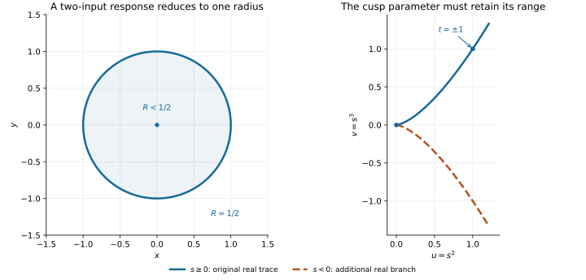

# Applications

Algebraic geometry exposes the equations, multiplicities and relations behind a polynomial model. The [scheme fibers](../examples/scheme_fibers.py), [primary components](../examples/primary_components.py), [graded resolution](../examples/graded_resolution.py) and [curve normalization](../examples/curve_normalization.py) scripts cover ramification, embedded support, Betti invariants and birational curve models. Their detailed tutorials are [schemes](schemes.md), [components](components.md), [resolutions](resolutions.md) and [curves](curves.md).

[Local geometry](../examples/local_geometry.py) measures the cusp at its singular point and its intersection with a tangent line. [Module arithmetic](../examples/module_arithmetic.py) computes exact kernels, Hom and tensor products. [Finite-field points](../examples/finite_points.py) counts all points on affine and projective models over GF(3) and GF(9). [Affine normalization](../examples/affine_normalization.py) compares a certified finite projection with finite birational integral closures, including a positive-genus curve and a singular surface. The tutorials specify [local](local_geometry.md), [module](modules.md), [finite-field](finite_fields.md) and [normalization](normalization.md) scope.

Functional decomposition exposes intermediate quantities that can be used in a calculation. These examples start with an equation, a response model, a parametrized curve, or a coefficient constraint and carry the recovered structure through to an answer. The scripts use exact arithmetic and contain executable checks.

| Task | What decomposition contributes | Result | Script |
| --- | --- | --- | --- |
| Solve an expanded sextic | A cubic outer map and a quadratic inner map | All six distinct complex roots, including four real roots | [solve_equation.py](../examples/solve_equation.py) |
| Find a response contour | A scalar intermediate depending on two inputs | The half-response contour is the unit circle | [response_contours.py](../examples/response_contours.py) |
| Remove a redundant curve parameter | A shared right component and exact field coordinates | A rational cusp parametrization with a generic inverse | [curve_reparametrization.py](../examples/curve_reparametrization.py) |
| Design two quadratic stages | An exact condition on quartic coefficients | A coefficient equation and explicit component formulas | [quadratic_towers.py](../examples/quadratic_towers.py) |

Install the matching backends as described in the README. The response and coefficient examples require the real extra. Run a script from the package directory with a command such as `python examples/solve_equation.py`.



The circle is the exact half-response contour of the model below. The cusp plot distinguishes the original real trace from the additional branch reached by allowing a negative new parameter.

## Solve an equation in stages

Suppose an expanded equation is

\[ x^6+3x^5+3x^4+x^3-x^2-x=0. \]

Decomposition recovers a convenient representation with `h(x)=x**2+x` and `g(u)=u**3-u`. First solve `g(u)=0`, giving `u=-1,0,1`; then solve each quadratic equation `h(x)=u`. This is a concrete use of decomposition in [symbolic root finding](https://www.cs.cornell.edu/~kozen/Papers/poly.pdf).

```python
import sympy as sp
from alggeom.decomposition import decompose

x = sp.Symbol("x")
f = x**6 + 3 * x**5 + 3 * x**4 + x**3 - x**2 - x
components = decompose(f, x)
values = [sp.S.Zero]
for component in components:
    values = [
        root
        for value in values
        for root in sp.solve(component.expr - value, component.variables[0])
    ]
assert len(set(values)) == 6
assert all(sp.simplify(f.subs(x, root)) == 0 for root in values)
```

The real roots are `0`, `-1`, and `(-1 ± sqrt(5))/2`; the remaining pair is `(-1 ± I*sqrt(3))/2`. The script verifies that their linear factors reconstruct the original polynomial, so no roots are missing. This example is squarefree and the component equations have complete low-degree solutions. Recovering a composition does not make arbitrary component equations solvable by radicals.

Components are returned outermost first, which is also the order used to invert them. Their printed formulas can change under a change of intermediate coordinate; the workflow uses the returned Lambdas directly.

## Reduce a response contour to a scalar problem

Consider the illustrative response model

\[ R(x,y)=\frac{(x^2+y^2)^2}{1+(x^2+y^2)^2}. \]

For the target response `R=1/2`, the recovered scalar equation is `t**2/(1+t**2)=1/2`. It has candidates `t=-1` and `t=1`. The intermediate quantity `x**2+y**2` is nonnegative on real inputs, so only `t=1` occurs. The resulting contour is `x**2+y**2=1`.

```python
import sympy as sp
from semialg.decision import equivalent, is_satisfiable
from alggeom.decomposition.rational import search_rational

x, y, t = sp.symbols("x y t", real=True)
q = x * x + y * y
response = q * q / (1 + q * q)
(pair,) = search_rational(response, (x, y), parameter=t).decompositions
candidates = sp.solve(pair.outer - sp.Rational(1, 2), t)
levels = [value for value in candidates if is_satisfiable(sp.Eq(pair.inner, value), (x, y))]
contour = sp.Or(*(sp.Eq(pair.inner, value) for value in levels))
assert len(candidates) == 2 and len(levels) == 1
assert equivalent(contour, sp.Eq(q, 1), (x, y))
```

The original denominator is positive for real inputs. In more general rational models, denominator guards also belong in the contour and in any subsequent domain check. This is a constructed model illustrating exact symbolic reduction; no experimental data or fitted coefficients are assumed.

## Remove a redundant parameter from a curve

The parametrization `P(t)=(t**4,t**6)` has image on the cusp `v**2=u**3`. It takes `t` and `-t` to the same point. Decomposing its first coordinate exposes a right component that can also express the second coordinate.

The script uses alggeom for the decomposition and the algroots function-field interface to transport both coordinates through the recovered generator. A convenient result is `s=t**2` and `Q(s)=(s**2,s**3)`, with `P=Q∘h`. On the part of the curve where `u != 0`, the rational inverse is `s=v/u`.

```python
import sympy as sp
from algroots.function_fields import luroth_generator
from alggeom.decomposition.rational import search_rational

t, s = sp.symbols("t s")
(pair,) = search_rational(t**4, t, parameter=s).decompositions
field = luroth_generator([pair.inner], variables=(t,), parameter=s)
coordinates = tuple(field.express(value).expression for value in (t**4, t**6))
assert sp.cancel(coordinates[1] ** 2 - coordinates[0] ** 3) == 0
assert all(
    sp.cancel(field.to_ambient(new) - old) == 0
    for new, old in zip(coordinates, (t**4, t**6), strict=True)
)
assert not field.contains(t)
```

The rational inverse makes `Q` a birational parametrization; it is undefined at the cusp point `(0,0)`, which `Q(0)` still reaches. The tests check the inverse on the implicit curve as well as on the parametrized image. This workflow combines existing interfaces for this curve; it is not a general curve reparametrization entry point.

Real parameter ranges require separate attention. Real `t` gives `s=t**2 >= 0`, so the original real parametrization traces the upper cusp. Letting `s` range over all real numbers also traces the lower cusp. Keep `s >= 0` when preserving the original real trace. Algebraic equality of the image curve alone does not preserve that range restriction.

## Find a coefficient condition for two quadratic stages

Suppose a quartic `x**4+a*x**3+b*x**2+c*x` must be represented as two quadratic maps. Normalizing the inner map to be monic with zero constant term gives

\[ h(x)=x^2+\frac a2 x,\qquad g(t)=t^2+\left(b-\frac{a^2}{4}\right)t. \]

The coefficient of `x` matches precisely when `a**3-4*a*b+8*c=0`.

```python
import sympy as sp
from alggeom.decomposition import decomposition_condition
from alggeom.decomposition.parameters import polynomial_pair

x, t, a, b, c = sp.symbols("x t a b c", real=True)
f = x**4 + a * x**3 + b * x * x + c * x
condition = decomposition_condition(f, x, degrees=(2, 2), parameters=(a, b, c))
assert condition.subs({a: 2, b: 3, c: 2}) is sp.true
assert condition.subs({a: 2, b: 3, c: 1}) is sp.false
pair = polynomial_pair(f, x, degrees=(2, 2), parameters=(a, b, c), component_variable=t)
assert sp.expand((pair.composition - f).subs(c, a * b / 2 - a**3 / 8)) == 0
```

At `a=2,b=3,c=2`, the stages are `h(x)=x**2+x` and `g(t)=t**2+2*t`. Changing `c` to `1` prevents this polynomial split. The tests compare several satisfying and failing coefficient assignments with SymPy's separate polynomial decomposition algorithm. Use `polynomial_family` when a varying leading coefficient can cause degree drops; the fixed-degree condition only applies at the declared degree.
