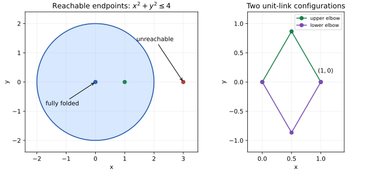

# Worked applications

Each script is an executable source of assertions, with a catalog entry tested against installed wheels outside the source checkout. Run a script after installing the package and its declared dependency profile.

## Cusp normalization and a real branch

On y²=x³ the normalization parameter is t=y/x, with x=t² and y=t³. The fiber x=1 has two points (1,±1), while the upper real branch retains (1,1). The [cusp script](../examples/cusp_branch.py) verifies the birational identities, finite fiber length and totality and single-valuedness of the selected real graph, together with its rational inverse and the preimage of the origin. The condition t≥0 is part of the graph; algebraic normalization alone does not preserve it.

## Parameter-dependent quadratic fibers

The generic equation ax²+bx+c=0 has finite length two over QQ(a,b,c). At a=0 it can become linear, empty or the whole affine line. The [quadratic fiber script](../examples/quadratic_fibers.py) compares these fibers with an exact real existence condition. Generic finite algebra and semialgebraic parameter strata answer different questions.

## Finite-field point counting

The [finite-point script](../examples/finite_points.py) enumerates a parabola, projective line and projective plane over GF(3) and GF(9). Expected counts are q, q+1 and q²+q+1. These are complete field-valued point sets within their ambient candidate budget, with no real-branch interpretation.

## Polynomial linkage workspace

Two rigid links of length one have elbow (u,v) and endpoint (x,y), satisfying u²+v²=1 and (x-u)²+(y-v)²=1. Simultaneous rotation preserves both equations. Rotating the endpoint to (r,0), r≥0, reduces real quantifier elimination to one free parameter. The [linkage script](../examples/linkage_workspace.py) proves 0≤r≤2, hence the reachable workspace is x²+y²≤4. The constructive elbow (r/2, sqrt(1-r²/4)) verifies sufficiency, including the fully folded endpoint at r=0.

The reduction avoids a large two-parameter Cartesian elimination while preserving the full geometry by rotational invariance. The alggeom application also computes the two-point elbow fiber over endpoint (1,0). Angles are represented by constrained algebraic coordinates; the solver is not treating transcendental trigonometric expressions as polynomials.

The quadratic examples use the exact identity 4a(ax²+bx+c)=(2ax+b)²-(b²-4ac). On a≠0 the affine change is invertible, so a one-parameter real-root projection supplies the discriminant condition. Linear and constant strata are checked separately. This avoids an unnecessarily large three-parameter CAD while preserving the full parameter classification analytically.

